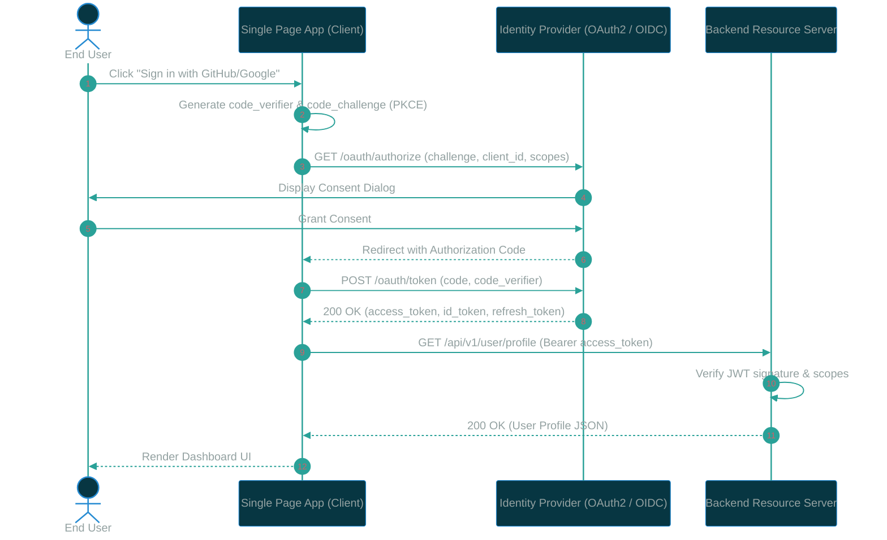
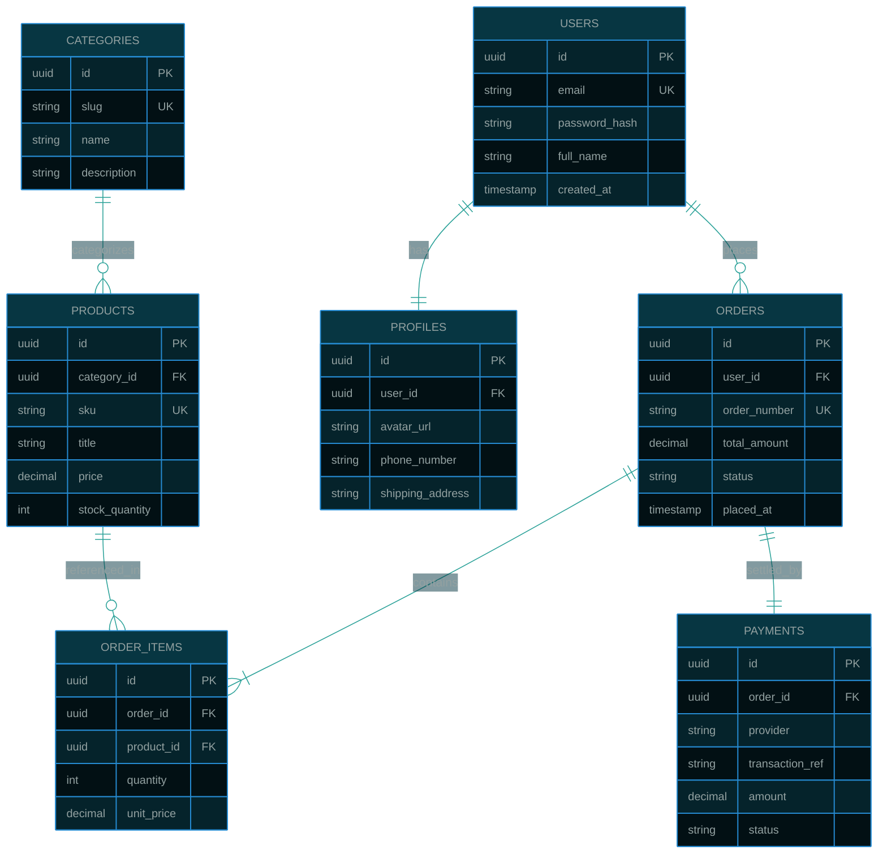
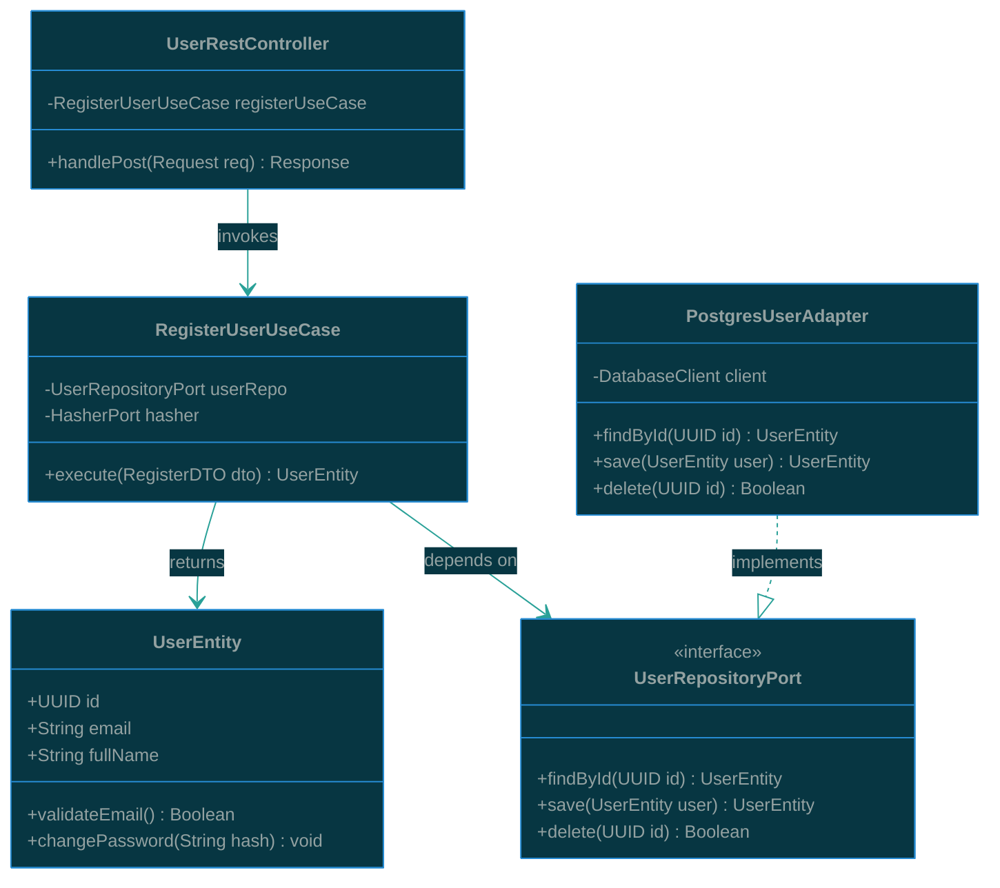
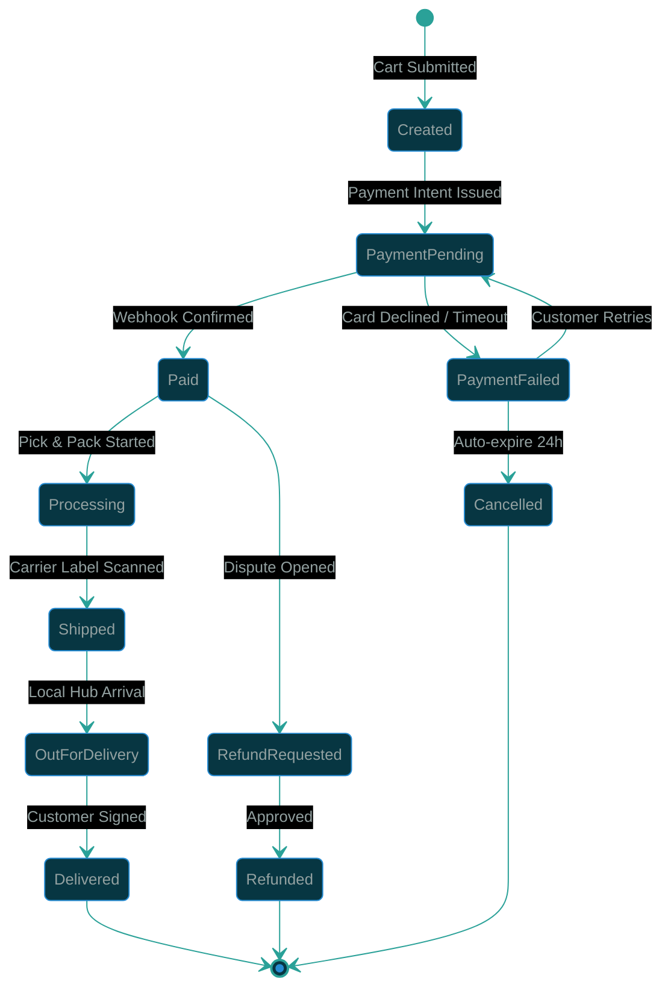
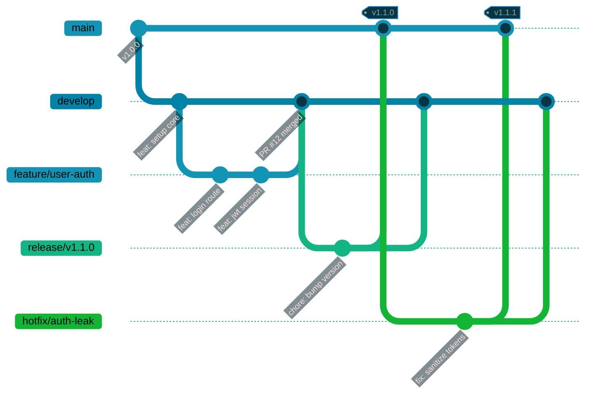
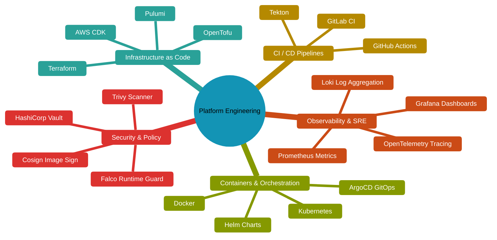

# Diagram-studio

The purpose of the document is to test the mermaid diagram studio works corectly.

By going across all the sub tabs,
- **flowchart**
- **Sequence** 
- **er model** 
- **class**
- **state**
- **git graph**
- **mind tree**

```mermaid
%%{init: {"theme":"base","themeVariables":{"darkMode":true,"background":"#002b36","primaryColor":"#073642","primaryTextColor":"#93a1a1","textColor":"#93a1a1","nodeTextColor":"#93a1a1","mainBkg":"#073642","primaryBorderColor":"#268bd2","lineColor":"#2aa198","secondaryColor":"#001e26","tertiaryColor":"#073642","actorBorder":"#268bd2","actorBkg":"#073642","actorTextColor":"#93a1a1","actorLineColor":"#2aa198","signalColor":"#2aa198","signalTextColor":"#93a1a1","fontFamily":"Inter, sans-serif","fontSize":"13px","mindmapRootColor":"#268bd2","mindmapRootTextColor":"#ffffff","cScale0":"#268bd2","cScaleLabel0":"#ffffff","cScale1":"#2aa198","cScaleLabel1":"#ffffff","cScale2":"#859900","cScaleLabel2":"#ffffff","cScale3":"#b58900","cScaleLabel3":"#ffffff","cScale4":"#cb4b16","cScaleLabel4":"#ffffff","cScale5":"#dc322f","cScaleLabel5":"#ffffff","cScale6":"#d33682","cScaleLabel6":"#ffffff","cScale7":"#6c71c4","cScaleLabel7":"#ffffff"}}}%%
flowchart TD
  subgraph Public_Zone ["Public DMZ & Ingress"]
    CDN([Cloudflare Edge CDN])
    APIGW[API Gateway :: Envoy]
    CDN -->|HTTPS / WSS| APIGW
  end

  subgraph Private_Mesh ["Private Service Mesh (K8s)"]
    APIGW --> AuthSvc[Auth & Policy Svc]
    APIGW --> AppSvc[Core Application API]
    APIGW --> PaymentSvc[Payment Processing Svc]
    AppSvc --> Worker[Background Task Worker]
  end

  subgraph Data_Tier ["Persistence & Streaming Tier"]
    AppSvc --> Cache[(Redis Cache Cluster)]
    AppSvc --> DB[(PostgreSQL Primary)]
    Worker -->|Async Events| Broker{{Kafka Event Bus}}
    PaymentSvc --> Stripe([Stripe External API])
  end

  style Public_Zone fill:#1e1e38,stroke:#6366f1,stroke-width:1px
  style Private_Mesh fill:#152238,stroke:#38bdf8,stroke-width:1px
  style Data_Tier fill:#1a2822,stroke:#10b981,stroke-width:1px
```

