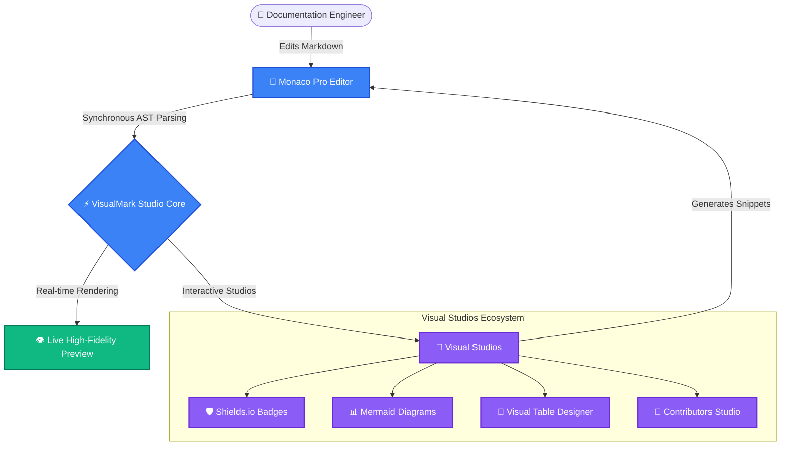

##  Welcome
# 🚀 Welcome to VisualMark Studio Playground

> [!TIP]
> **Live Interactive Preview**: Edit anything in the editor on the left (or toggle views using the top bar), and watch the live preview render synchronously on the right!

---

## ⚡ Quick Architecture Overview


<details>
<summary>Here is a live Mermaid Architecture Flowchart. Try changing the text or node connections in the editor:</summary>



</details>


## 🛡️ Interactive Badges

You can generate customizable Shields.io badges visually using the **Shields.io Badges Studio** (`Badges` tab above):


---

## 📊 Live Markdown Table

Use the **Table Designer Studio** to visually craft, sort, and format tables without typing markdown pipes by hand:

| Feature | VisualMark Studio | Standard Editors | Benefits |
| :--- | :---: | :---: | :--- |
| **Monaco Integration** | ✅ Native | ⚠️ Basic Textarea | VS Code level intellisense, keybindings & multiselect |
| **Mermaid Visual Studio** | ✅ Built-in GUI | ❌ Plugin Needed | Visual flowchart, sequence, and ER diagram authoring |
| **Theme System** | ✅ 10 Themes (Dark & Light) | ⚠️ Generic Dark only | Calibrated contrast in Dracula, Tokyo Night, Solarized, etc. |
| **Offline First** | ✅ 100% Local Disk | ❌ Cloud Lock-in | Zero latency, total privacy, zero telemetry |

---

## 💡 Quick Tips & Pro Shortcuts

- **Command Palette**: Press <kbd>Ctrl</kbd> + <kbd>K</kbd> to access all studio commands, theme switchers, and actions.
- **Split / Zen Views**: Toggle between Split Mode, Full Editor, and Full Preview from the top bar.
- **Visual Studios**: Check out the tabs above for **Mermaid Diagrams**, **Shields Badges**, **Table Designer**, and **Changelog Generator**.
- **Exporting**: Click **File > Export PDF** or **Export HTML** to generate presentation-ready documentation instantly.

*Enjoy engineering extraordinary documentation!*
## 👥 Contributors & Acknowledgements

Thanks goes to these wonderful people for contributing to this project:

<table>
  <tr>
    <td align="center" width="20%">
      <a href="https://github.com/octocat">
        <br />
        <sub><b>The Octocat</b></sub>
      </a><br />
      <span title="Code">💻</span> <span title="Docs">📖</span> <span title="Infra / CI">🔧</span>
    </td>
    <td align="center" width="20%">
      <a href="https://github.com/torvalds">
        <br />
        <sub><b>Linus Torvalds</b></sub>
      </a><br />
      <span title="Code">💻</span> <span title="Review">👀</span> <span title="Infra / CI">🔧</span>
    </td>
    <td align="center" width="20%">
      <a href="https://github.com/gaearon">
        <br />
        <sub><b>Dan Abramov</b></sub>
      </a><br />
      <span title="Code">💻</span> <span title="Docs">📖</span> <span title="Ideas & Spec">💡</span> <span title="Design">🎨</span>
    </td>
    <td align="center" width="20%">
      <a href="https://github.com/yyx990803">
        <br />
        <sub><b>Evan You</b></sub>
      </a><br />
      <span title="Code">💻</span> <span title="Design">🎨</span> <span title="Review">👀</span>
    </td>
    <td align="center" width="20%">
      <a href="https://github.com/sophiebits">
        <br />
        <sub><b>Sophie Alpert</b></sub>
      </a><br />
      <span title="Code">💻</span> <span title="Tests">🧪</span> <span title="Review">👀</span>
    </td>
  </tr>
</table>

### 💖 Sponsors & Backers

Support this project by becoming a sponsor. Your avatar or organization logo will appear here with a link to your profile!

[](https://github.com/sponsors)

### `POST` /api/v1/auth/login

> Authenticate user with email and password to receive JWT bearer token.

- **Authentication:** `Bearer JWT`

#### Request Parameters

| Name | In | Type | Required | Description |
| :--- | :---: | :---: | :---: | :--- |
| `email` | `body` | `string` | ✅ Yes | Registered user email address |
| `password` | `body` | `string` | ✅ Yes | Account secret password |

#### Request Payload

```json
{
  "email": "alex@example.com",
  "password": "secretpassword123"
}
```

#### Response (`200 OK`)

```json
{
  "token": "eyJhbGciOiJIUzI1NiIsInR5cCI6IkpXVCJ9.eyJzdWIiOiJ1c3JfOTgxIn0...",
  "token_type": "Bearer",
  "expires_in": 86400,
  "user": {
    "id": "usr_981",
    "email": "alex@example.com",
    "role": "developer"
  }
}
```